  

<h1 align="center">Md Kaif Nezami</h1>

<b>Robotics and UAV Autonomy</b> · ROS 2 · LiDAR SLAM · Python 
B.Tech Electronics and Communication Engineering, BIT Sindri (2024 - 2028)

---

## About

I build autonomy software for drones and mobile robots that must work **without GPS**: LiDAR SLAM, sensor integration, simulation and hardware bring-up, mostly in **Python** and **ROS 2**.

**Currently:** Project Intern at the Drone Electronics Laboratory, IIT (ISM) Dhanbad, working on the **NIDAR 2.0 AirMouse** mission (indoor GPS-denied search and mapping).

---

## Featured Projects

### [Drone SLAM Simulator](https://github.com/nezamimdkaif/drone-slam-simulator)
2D LiDAR SLAM with Google Cartographer for a quadrotor in a Gazebo maze, with a live web dashboard, phone control and test tools that score SLAM against ground truth.
- Found that loop closure **increased** mean error from **0.10 m to 0.42 m** (3 runs each) in a repetitive maze due to false matches.
- Same SLAM config and dashboard run on the real drone (Raspberry Pi 4 + RPLIDAR A2M12 + Pixhawk IMU over MAVROS).

`ROS 2 Jazzy` `Gazebo Harmonic` `Cartographer` `Python` `RViz` `FastAPI`

### LiDAR SLAM on real hardware
- Raspberry Pi 4 (ROS 2 Humble) + RPLIDAR A2M12; Pixhawk 6C IMU streamed at 50 Hz over MAVLink (UART, 921600 baud).
- Fixed multi-machine ROS 2 over WiFi (blocked DDS multicast) with Fast DDS unicast peers; live scans in RViz.

`ROS 2` `MAVROS` `MAVLink` `Fast DDS` `Linux`

### UAV flight-log analysis
- Analysed 19+ ArduPilot/PX4 logs with pymavlink: GPS/compass inconsistency was the most frequent anomaly (26 events in 7 logs); vibration peaked at 62.7 m/s².
- Reconstructed and animated flight trajectories from DataFlash logs.

`Python` `pymavlink` `NumPy` `Matplotlib` `OpenCV`

### Vision-based precision landing
- Nested ArUco markers (0.2 - 15 m range) for pose estimation on a Raspberry Pi 4; Python ROS 2 nodes command a Cube Orange over MAVROS. Verified in simulation.

`OpenCV` `ROS 2` `MAVROS` `PX4 SITL` `Gazebo`

---

## Highlights

- **ISRO IRoC-U 2026**, Team AADISHAKTI: reached the elimination round (GPS-denied autonomous drone); built the ground station.
- Secured **INR 1,00,000 sponsorship from SAIL** for the IRoC-U team.
- **NIDAR 2.0** participant, representing IIT (ISM) Dhanbad.

---

## Skills

| Area | Tools |
|---|---|
| Programming | Python (primary), Bash, C++ (basic) |
| Robotics software | ROS 2 (Humble, Jazzy), rclpy, TF2, RViz, colcon, Fast DDS |
| Perception and localization | Cartographer LiDAR SLAM, OpenCV, ArUco pose estimation |
| Simulation and autopilots | Gazebo, PX4 SITL, ArduPilot SITL, PX4, ArduPilot, MAVLink, MAVROS |
| Hardware | Raspberry Pi 4/5, Pixhawk 6C, Cube Orange, RPLIDAR, optical flow |
| Tools | Linux (Ubuntu), Git, Docker, LaTeX, QGroundControl, Mission Planner |

---

<i>Open to robotics, ROS 2 and UAV autonomy internships.</i>

